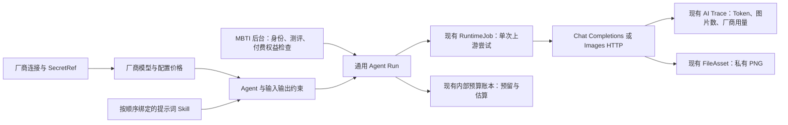

# 通用 AI 中心与 MBTI 项目接入

适用：AF-121..124 的 dev 版本。底座提供通用 AI；MBTI 题库、评分、关系、业务订单与权益归业务项目。真实厂商调用、商户支付与生产发布没有在本批执行。

## 已实现的调用链



`AiRuntimeModule` 导出 `AiCenterRunService`。MBTI 业务模块可以依赖它，在检查业务订单、权益和本次操作幂等后调用 `submit(memberId, workspaceId, agentCode, {input, idempotencyKey}, correlationId)`；服务还会独立检查活跃成员、Workspace 权限、插件、Agent、预算和凭据。业务权益消费需要与业务自身幂等状态机配合；不要因 HTTP 超时再次扣除权益。

`AI_CENTER_CLIENT_EXECUTION_ENABLED=false` 是默认值，关闭直接客户提交入口，不影响业务模块内部调用。若业务将 API 作为独立服务运行，应先实现受信任业务服务身份/授权适配；不要为绕过付费检查而公开打开客户入口。设为 true 表示允许持有 Workspace AI execute 权限的成员直接调用已发布 Agent，适合明确按 Workspace 预算提供的免费/试用功能。这不是支付权益实现。

## 项目装配边界

本批是在现有dev宿主中交付通用AI模块，可先组合MBTI业务模块开发。现有`aij:project create`生成的aij-base配置仍限制插件，现有数据库Seed限定本宿主，因此不能把本说明当成独立MBTI工程的一键初始化承诺。独立新仓库/命名空间/数据库需要补齐项目装配与Seed适配并做真实启动验收；不要简单改PROJECT_ID或复制旧库绕过约束。

## 管理配置

1. 在独立部署环境按既有数据库流程核对目标、应用迁移。新迁移 `20261104020000_general_ai_runs` 已在新建隔离测试库验证，未应用到本地开发、共享或生产库。
2. 在该环境显式执行现有 Seed 命令的 `--ai-center` 选项：注册配置管理、密钥管理、运行读取权限及两个菜单；不覆盖已有账号、角色授权或同路径异主菜单，也不自动安装/启用插件。管理员权限仍通过 RBAC 管理。
3. 启动配置包含 `ENABLED_PLUGINS=aij-ai`，并使用插件管理接口安装/启用 `aij-ai`。持久安装状态与启动加载列表两者都必须允许；仅写启动变量不会自动启用安装。
4. 后台 `/auth/secrets` 创建本项目环境内的 SecretRef，并通过环境或现有本地密钥存储配置真实值。不要把 API Key 填入 AI 配置、仓库或提示词。
5. `/auth/ai/center` 顺序新增厂商连接、模型、Skill、Agent。Agent 启用并发布前，模型、厂商和所有 Skill 必须已启用。保存使用整体 expectedVersion；实体 revision 由服务端维护。当前配置在 ScopedConfig/ConfigurationChange 中审计，保存失败不会部分更新。
6. 设置项目和每个 Workspace 月度预算。部署配置按需开启 `AI_CENTER_LIVE_ENABLED=true`，厂商连接也须开启 liveEnabled。生图还要求 `STORAGE_ENABLED=true`；异步工作者需要 `ASYNC_RUNTIME_ENABLED=true`。默认不开启付费外部调用。
7. `/auth/ai/usage` 查看内部估算、预留、Token、图片数、Agent 与最近50次运行；`/auth/ai/traces` 查询既有运行摘要与厂商实际成本回执（若有）。

`--ai-center` 的命令形式沿用仓库 `pnpm db:seed -- dev|test ... --ai-center`；生产数据库管理不在该本地 Seed 工具权限内。不要将验收库连接参数复制到真实环境。

中心读取需要 `admin.config.manage`；保存额外要求 `admin.secret.manage`；用量读取需要 `admin.runtime.read`。新增 `workspace.ai.execute` 与 `workspace.ai.read`，新建 Workspace OWNER 具备；迁移补充已有活跃系统 OWNER，MEMBER 不默认开放。结果读取还绑定创建成员，同 Workspace 其他成员也不能读取个人输入/输出或生成图片。

## 协议与模型范围

首版使用非流式 `/chat/completions` 和 `/images/generations`。兼容接口是协议要求，不表示所有厂商/模型参数都相同。管理员填写真实模型 ID，并选择 `max_tokens` 或 `max_completion_tokens`。没有自动发现模型、模型可用性探测或真实调用测试按钮。

内置批准基础地址为 `https://api.openai.com/v1` 与 `https://api.deepseek.com/v1`；其他兼容厂商或代理须由部署侧在 `AI_CENTER_ALLOWED_BASE_URLS` JSON 数组中批准精确 HTTPS base URL。请求不跟随重定向，不接受客户端自选 URL、模型或密钥。

DeepSeek 仍受已有 `AI_DEEPSEEK_LIVE_ENABLED`、`AI_DEEPSEEK_UPSTREAM_CONFIRMED`、`AI_DEEPSEEK_DATA_CLASS=synthetic-or-deidentified` 约束。把连接改名或改为 compatible 不会绕过官方 DeepSeek 地址门禁。真实 MBTI 用户内容不应仅凭设置变量就宣称已去标识；上游用途/处理区域/删除条件及数据分类需要在真实接入时完成。

图像首版固定单张 PNG、三种配置尺寸、配置质量，接受受限 base64（8MB、PNG 头与尺寸边界），不下载上游返回的任意 URL。原生 GPT Image 模式发送 output_format=png；需要 response_format=b64_json 的兼容模式由模型配置启用；其他生图协议需新增适配。没有图片编辑、人脸上传、多图输出或内容审核运营台。

协议实现参考官方 [Chat Completions](https://developers.openai.com/api/reference/resources/chat/subresources/completions/methods/create) 与 [Image generation](https://developers.openai.com/api/docs/guides/image-generation)，2026-11-04 查阅。代码不硬编码“当前最佳模型”或外部价格。

## 建议的 MBTI 配置

| 通用 Agent | 模型能力 | Skill 示例 | 输入字段 | 业务检查 |
| --- | --- | --- | --- | --- |
| buddy-advice | 文本 | respectful-social-advice、avoid-stereotypes | selfType、buddyType | 本人成绩、搭子资料可见性与建议额度 |
| assessment-explanation | 文本 | mbti-report-style、avoid-sensitive-inference | mbtiType、dimensionSummary | 服务端评分结果、报告权益 |
| avatar-maker | 生图 | avatar-art-direction | mbtiType、style | 生图权益、订单有效性与内容限制 |

Skill V1 是提示词指令集合，按绑定顺序加入系统指令，不是任意 SKILL.md 执行器。输入为指定名称的必填字符串字段，每项最多2000字符；文本输出为字符串，或配置字段组成的字符串值 JSON 对象。复杂嵌套 JSON Schema、工具/MCP、长程记忆、多步骤工作流、RAG检索编排不在本批。现有知识问答保持独立入口，没有自动注入所有 Agent。

建议 MBTI 成绩在业务服务计算并保存，AI 用于解释与建议，避免依赖模型作为确定性计分器。用户请求的类型值与实际结果关系由业务服务验证。

## SDK 与 HTTP

`@aij/sdk` 导出 `createAiClient(createClientApi(...))`：listAgents、submit、read、imagePath。如下只适用于已明确开放直接客户入口的免费/试用场景；付费路径应在业务服务完成权益检查。

```ts
const ai = createAiClient(createClientApi(() => apiBase));
const agents = await ai.listAgents(workspaceId);
const run = await ai.submit(workspaceId, 'buddy-advice',
  { selfType: 'ENFP', buddyType: 'INTJ' }, operationId);
const latest = await ai.read(workspaceId, run.id);
```

POST `/api/client/ai/agents/:code/runs` 返回202，GET `/api/client/ai/runs/:id` 查询；请求使用客户会话与 `x-aij-workspace-id`。创建要求同源 Origin，SDK浏览器请求自动携带会话 Cookie；跨站403。相同幂等键+相同输入重放原运行，不再入队或预留；相同键不同输入409。调用方持久保存 operationId，页面刷新和网络重试继续使用原值。

图片通过 GET `/api/client/ai/runs/:id/image`，同样需要会话与 Workspace header；网页应 fetch 为 Blob，创建 object URL 展示并在卸载时 revoke。不能把带有私密查询参数的 URL 作为公开图片地址。图片无公共分享权限。

## 费用、状态与保留期

配置价格全部为 CNY，API nanos 字符串表示十亿分之一元。文本入队预留“上下文Token上限×输入价＋最大输出Token×输出价”，成功后按实际输入/输出 Token 与配置价格结算；缓存 Token 记录用量，但估算仍按输入全价。生图按单张配置价估算，不能据此保证厂商实际费用上限。

预算按入队时间的 UTC 自然月归集，项目与 Workspace 并发提交在锁内校验。估价是内部经营口径，Trace 的 costAmountNanos 只有厂商权威回执才可填写。本适配记录厂商 Token/图片数，没有伪造厂商账单。

| 状态 | 含义 | 预算 |
| --- | --- | --- |
| queued / running | 等待或执行中 | 已预留 |
| succeeded | 结果与Trace、预算原子保存 | 内部估算结算 |
| failed | 在发送上游前被拒绝/取消 | 释放未使用预留 |
| unknown | 请求可能已到达上游，结果/费用不确定 | 保留预留，不自动重试 |

单次上游尝试，无自动计费重试；旧租约及重复 admission 有围栏，仍不承诺外部 exactly-once。进程丢失后读取会把终止任务的运行标为不确定并保留预算。需再次生成时用新的业务操作和幂等键，并明确处理新费用。没有自动对账后释放未知费用的工具。

输入、输出与配置快照7天到期不可读取，小时清理每轮最多100条；大流量需提高受控清理吞吐并监控积压。生成图片保留在独立文件生命周期中，不随文本过期删除。审计、Trace 只保存操作或形状摘要，不保存原文/真实凭据。保留策略不是完整的用户数据删除流程。
