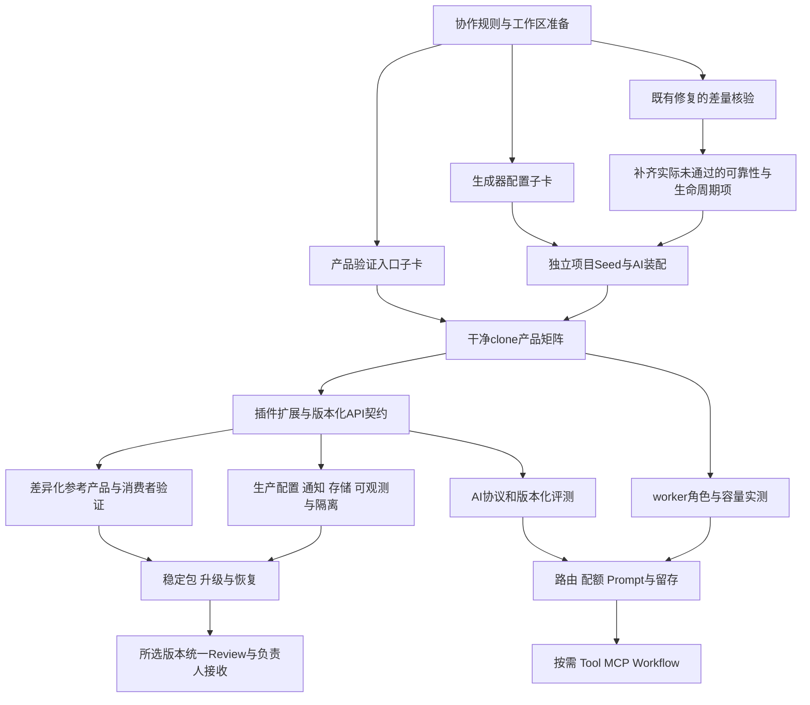

# AIJ Foundation 在 Orca 中的优化编排方案

基线：`dev@bb00ffdd0e0d5c103c6595b02315513407a0a575`，2026-11-04。本文是编排设计与派工模板，**本轮没有创建新的Orca Run、启动Worker、分配正式AF编号或修改产品代码/AGENTS/正式队列**。此前逐节点提交推送、最终统一Review的交付要求继续作为执行方案约束。

来源：[原28项优化清单](AIJ_FOUNDATION_OPTIMIZATION_BACKLOG_20261104.md)、[MBTI AI交付现状](../review/MBTI_AI_FOUNDATION_REVIEW_20261104.md)。[机器可读依赖与资源计划](AIJ_FOUNDATION_ORCA_ORCHESTRATION_20261104.json)是本仓库交接格式，不是Orca原生导入格式；实际建图需逐次调用已核对的task-create。

## 1. 推荐组织：一个总控，最多三个Worker，一个dev集成入口

总控在当前`dev`工作区协调、分配文件/共享资源、执行正式集成验证、更新队列并逐卡提交推送。开发Worker在从已验证`origin/dev`创建的独立Orca worktree中完成候选成果。只读审查不能同时修改原Writer负责的实现；修复回到原Writer，交接后才能由总控集成。

| 逻辑工作流 | 覆盖工作包 | 主要边界 |
| --- | --- | --- |
| P 工程/契约/复用 | OPT-002/005/007/009/010/011/015 | 生成器、宿主装配、API契约、消费者与升级 |
| A AI能力与成本 | OPT-018/019/020/021/022/023/024/025 | AI协议、路由/配额、Prompt、检索/评测、按需工具 |
| R 运行时/生产/隔离 | OPT-001/003/004/012/013/014/016/017/026/027 | 租约、容量、生产配置、通知/文件与数据治理 |
| Q 验证与状态材料 | OPT-006/008/028 | 干净环境门禁、当前状态源、验收材料；负责人决定不由Worker代做 |

这是逻辑归属，不是四个永久并发开发者。三个Worker名额按依赖动态分配；首批为差量核验R、生成器P、验证入口Q，AI增强待其真实依赖满足后占用名额。需要审查时可以采用“两个开发Worker＋一个只读审查Worker”。不额外强制Trea复核。

本机读取为32GiB内存、10逻辑CPU，先以总控＋最多3个Worker开始；重型Next全构建仅1个、DB建库/迁移及当前受保护验收仅1个。模型沿用用户在Orca中配置的默认值，不批量改变模型/effort。没有证据支持把241–409小时除以3来承诺完工日期。

## 2. 必须先对齐原清单

原清单基线是`5bd33fd`，之后已发生AF-121..124交付。当前不能照原清单把全部28项重新实施，也不能把局部修复当作原工作包全部通过。差量核验前不更新原提案的“已完成”状态，不改负责人验收记录。

例如：运行与管理已共用TRUSTED_PLUGINS，但启动脚本还有单独白名单；AI已有文本/图片/Agent/Skill与月预算，但原OPT-018还要求流式协议，OPT-019还要求路由/用户配额/熔断，OPT-020还要求会话/记忆。已有实现应复用，剩余验收应拆卡补齐。

| 原项 | 当前对齐 | 后续重点 |
| --- | --- | --- |
| OPT-001 | 已有实现，待差量验收 | AF-121/123已修旧租约与重复准入，并为AI未知结果保留预算；仍按原完整验收复核独立执行者、恢复及各外部副作用语义。 |
| OPT-002 | 部分覆盖 | 运行与管理共用TRUSTED_PLUGINS；启动脚本仍有单独数组，AI正常安装启用尚需管理API闭环证据。 |
| OPT-003 | 部分覆盖 | 知识入口与菜单已有启停检查；补全部受管API矩阵及停用/写事务竞争验证。 |
| OPT-004 | 部分覆盖 | 已检查30秒心跳与错误；角色、启动宽限、积压与HTTP健康语义仍按原范围核验。 |
| OPT-005 | 待实现 | 生成器仍仅接受aij-base且禁止插件；Seed仍限定本宿主，必须补AI profile与独立项目初始化。 |
| OPT-006 | 部分覆盖 | 已有卡片验证及串行回归；尚未证明全新clone不依赖历史.artifacts的长期CI入口。 |
| OPT-007 | 部分覆盖 | 目录有收敛；权限、菜单、迁移和宿主扩展声明仍需统一，不能视为已完成插件契约。 |
| OPT-008 | 部分覆盖 | README/CURRENT新增当前入口；历史快照、长队列和registry仍未收敛成唯一状态源。 |
| OPT-009 | 待实现 | 原计划两个差异化参考产品尚未完成；MBTI可加作真实消费者，不静默替换原验收范围。 |
| OPT-010 | 部分覆盖 | 已有共享类型和手写createAiClient；尚未建立可生成SDK、统一错误与契约漂移检查。 |
| OPT-011 | 待实现 | 保持先有消费者证据，再抽稳定实现包与升级端口。 |
| OPT-012 | 待实现 | 生产配置仍需与本地保护隔离，当前不连接正式环境。 |
| OPT-013 | 部分覆盖 | 已改容量较保守的逐任务领取；尚无两worker容量/连接池/p95压测与独立角色证据。 |
| OPT-014 | 部分覆盖 | 已有Trace、用量页与预算摘要；完整请求关联、指标与告警仍未交付。 |
| OPT-015 | 待实现 | 私有源码打包已存在，但完整版本、升级失败恢复与所选edition发行验收未完成。 |
| OPT-016 | 待实现 | 客户验证/找回尚无真实可运行的生产通知交付适配。 |
| OPT-017 | 待实现 | 当前私有PNG复用本地FileAsset；对象/共享存储与多实例验证未完成。 |
| OPT-018 | 部分覆盖 | 已通用文本/JSON/单张PNG与兼容厂商选择；版本化消息协议、流式和原生多协议能力仍有差量。 |
| OPT-019 | 部分覆盖 | 已项目/Workspace月预算、配置价与快照；缺用户配额、路由/熔断、未知费用处置等。 |
| OPT-020 | 部分覆盖 | 已有Agent/Skill修订号和执行快照；尚无完整历史回滚、会话与记忆边界。 |
| OPT-021 | 待实现 | 现有知识问答是基础；异步索引、文档版本与大规模检索质量路线未完成。 |
| OPT-022 | 部分覆盖 | 已有合成协议和知识评测；通用版本化数据集/服务端评分/对抗比较尚未完成。 |
| OPT-023 | 按需求启用 | 仅有明确Tool执行需求后开卡；当前提示词Skill不算工具网关。 |
| OPT-024 | 按需求启用 | MCP是工具端口适配，不能跳过OPT-023资源授权。 |
| OPT-025 | 按需求启用 | Orca研发编排不等于产品内Workflow；产品Workflow另按checkpoint与副作用语义开发。 |
| OPT-026 | 按需求启用 | 有企业客户需求后做SSO/MFA/邀请，非MBTI首发一概前置。 |
| OPT-027 | 部分覆盖 | 新增AI结果已按成员/Workspace隔离并有TTL；全域导出/删除/恢复与留存治理仍需完成。 |
| OPT-028 | 负责人决策 | 准备验收材料可交付，负责人接收、main/tag、渠道/许可决定不可由Worker代填通过。 |

表中是源码/已交付证据的规划对齐，不是本轮重新运行产品验收。完整原依赖与原验收保留在JSON；当前剩余工时均留待差量开卡后重估，原241–409h仍只是历史候选总量。

## 3. 按依赖推进，不把所有优化变成一次大并行



图为概要，实际调度以JSON完整依赖为准。跨阶段并不等于可以越过依赖；子卡可以先交付独立部分，工作包出口必须满足原全部验收。

| 阶段 | OPT集合 | 阶段出口 |
| --- | --- | --- |
| S0 差量收敛 | 001/002/003/004/008 | 复用已交付修复；未通过项有补丁与实际复验，不重复造实现 |
| S1 工程复用 | 005/006/007/010 | base/ai-standard能独立初始化；正常安装AI；干净clone验证和版本化契约 |
| S2 消费与AI增强 | 009/013/018/019/020/022 | 真实扩展证据、容量数据、通用AI协议/评测；按包内依赖串联 |
| S3 生产候选 | 012/014/016/017/021/027 | 对所选部署/知识范围完成配置、通知、存储、可观测、留存与隔离验证 |
| S4 交付产品化 | 011/015/028 | 稳定运行包、可验证升级/恢复、统一材料和负责人发行决定 |
| S5 按需求开启 | 023/024/025/026 | 工具/MCP/Workflow/企业身份有明确需求时分别开卡，不阻塞基础版接收 |

MBTI首发另有一条业务支线：目标AI厂商真实小额度验收、商户支付Provider、MBTI订单/权益与确定性计分。这些并不全在原28项内；完成28项也不能自动宣称MBTI已经可以收费上线。业务代码进入业务项目，底座仅提供通用端口。真实厂商数据/预算、商户渠道/回调配置、独立业务仓库与题库规则尚需明确；可以先做离线适配和接口设计，外部等待不要阻塞无关Worker。

## 4. 首批：4张卡，12有效工程小时

正式AF编号在激活批次时由总控冲突扫描后分配，下面ORCH编号只是规划标识。每卡工时含本卡验证/集成预算，不另外隐瞒集成成本；实际超过4h先拆卡，不擅自扩批。

| 卡片 | 人员/工时 | 可并行性 | 验收边界 |
| --- | --- | --- | --- |
| [ORCH-GOV-01](orca-optimization-20261104/ORCH-GOV-01.md) 协作约束 | 原dev总控，2h | 必须先完成并集成 | 允许的子worktree、单任务Writer、dev单点集成、环境准备与资源限流 |
| [ORCH-DELTA-01](orca-optimization-20261104/ORCH-DELTA-01.md) 差量核验 | Worker R，3h | GOV集成后与下面两卡并行 | 原验收逐项映射、可复现失败与残项；捕获问题不等于功能通过 |
| [ORCH-GEN-01](orca-optimization-20261104/ORCH-GEN-01.md) 两edition配置契约 | Worker P，4h | 同上；只交独立配置子范围 | base默认无插件、ai-standard显式配置、身份隔离与非法配置拒绝 |
| [ORCH-CI-01](orca-optimization-20261104/ORCH-CI-01.md) 产品验证入口 | Worker Q，3h | 同上；不提前宣称完整CI出口 | 与历史AF基线解耦、缺条件失败、报告绑定SHA、DB组串行 |

GOV之后三个候选开发可并行，回收、DB验收、重型构建和dev提交串行。下一批再做GEN-02项目Seed、GEN-03仓库外完整消费、CI-02干净clone矩阵、STATE-01状态源；若差量核验发现基础门禁不满足，相关修复卡优先插入并重新计算批次预算。

## 5. 两种任务节点：开发完成和dev集成完成

```text
I-ORCH-GOV-01
 ├─ ORCH-DELTA-01 → I-ORCH-DELTA-01
 ├─ ORCH-GEN-01   → I-ORCH-GEN-01
 └─ ORCH-CI-01    → I-ORCH-CI-01
```

每张正式卡在Orca中分为“候选实现任务”和“总控集成任务”。候选Worker通过worker_done报告后，Orca可能将其Task标为completed；这仅表示候选任务结束。**依赖新代码的后续卡，必须依赖`I-*`集成Task的真实Orca ID。** 不能只依赖候选任务ID，更不能直接把OPT编号填进`--deps`。

集成Task仅由总控推进：[集成节点模板](orca-optimization-20261104/INTEGRATION_GATE.md)。确认候选基线/差异、接收交接、精确应用改动、跑正式verify:task和适用门禁、记录正式队列与执行证据、按任务原名提交并快进推送dev，远端SHA一致后才标completed。失败保持failed/blocked，修复由原Writer承担；不要因Worker退出或超时就填完成。历史负责人接收不随这些自动步骤改变。

## 6. 文件与资源的编排约束

| 资源 | 唯一写入/使用规则 |
| --- | --- |
| dev、正式队列、AF编号、执行状态 | 总控；Worker候选分支不得push dev |
| AGENTS.md、CURRENT_STATE、README汇总 | 总控；Worker提交各自独立说明，避免多人追加同一文件 |
| scripts/verification/registry.mjs、DB任务白名单 | 总控注册；Worker提供本卡独立测试与精确注册请求 |
| Prisma schema与migration序列 | 同时一个模型变更Writer；各任务提交模型/迁移提案，总控统一排序，依赖方先冻结契约 |
| contracts、全局权限、app装配入口 | 显式指定本阶段owner，冲突范围排队；不让多个任务各自改一版共享接口 |
| package.json、pnpm-lock.yaml | 总控串行处理依赖变更，先确认必要性；Worker不自行升级技术栈 |
| 数据库建库/迁移/Seed/当前DB验收 | 当前并发1，使用本仓库新建隔离库；不删除锁、迁移真实库或放松目标校验 |
| Next全构建、集成打包 | 当前并发1；普通纯函数测试可在各工作区并行 |
| node_modules/.next/.artifacts/上传目录 | 每个工作区自有，不链接到另一个工作区；共享pnpm下载缓存可以，不能共享可变项目目录 |

**Orca Task deps本身不提供这些文件锁、DB限流或自动Git集成。** 由总控在派发前检查资源表、任务写入范围和当前基线。能用依赖表达的冲突就写依赖；其余由资源占用记录限制。若待集成候选积压超过2张，先集成或修复，再派新开发，避免把问题留到批尾。

当前AGENTS第1节仍限定唯一写入目录，第2节仍规定Codex唯一Writer。它与多Worktree写入需要先对齐，不能让Worker自己解释为已豁免。GOV卡应将新模式明确为：仅本仓库已注册Orca子worktree可开发；每个任务仍只有一位Writer；原dev仅总控集成；原轻企仓库仍只读；单卡/批次预算、验收和资金/部署边界保留。**本次规划没有自行修改这条规则。** 在其落地前，可并行只读审计，产品代码仍维持原dev单Writer。

数据库/脚本现在含仓库身份及本机目录保护，复制一个worktree不代表已有自己的合规测试环境。OPT-006验证可移植准备流程前，受保护DB验收仍交回原dev总控；不能为并行而偷偷改连接目标或复制凭据。

## 7. Orca中实际怎样操作

已检查本机`/usr/local/bin/orca`的版本匹配指南及help，支持run-create、task-create/spec-file、deps、worker-start/new-child/base-branch、task-update。当前仓库默认新worktree基线已是origin/dev，旧barracuda仍停在初始提交，不能用于新任务。当前只有inspect-only legacy Run，本次未绑定新Run。

下面是激活时的操作模板，尖括号须替换为CLI实际回执ID；本轮没有执行这些写操作：

```sh
orca orchestration run-create --objective "AIJ优化 ORCA-B01：4卡/12h，逐卡集成dev，统一Review" --json

orca orchestration task-create --run <run-id> \
  --task-title "建立 Orca 并行写入与单点集成约束" \
  --spec-file docs/planning/orca-optimization-20261104/ORCH-GOV-01.md --json

# 为GOV创建总控集成Task，deps引用上一步实际Task ID。
# GOV集成Task完成后，其他三张卡才可派给Worker。
orca orchestration task-create --run <run-id> \
  --task-title "新增 base 与 ai-standard 配置契约" \
  --spec-file docs/planning/orca-optimization-20261104/ORCH-GEN-01.md \
  --deps '["<GOV-integration-task-id>"]' --json

orca orchestration worker-start --run <run-id> --task <GEN-task-id> \
  --agent codex --worktree new-child \
  --repo id:ab33c63f-00b7-40ab-a5de-fa58b189046d \
  --base-branch origin/dev --name opt-gen-01 --setup skip --json

orca orchestration task-list --run <run-id> --ready --brief --json
```

使用new-child是为隔离写入冲突。每个新Worker先核验实际HEAD与总控记录的基线、读取该工作区AGENTS，再在自己的工作区完成`pnpm install --frozen-lockfile`并检查退出状态；`--setup skip`避免当前仓库“agent与setup同时启动”策略悄悄重复安装。若采用仓库setup hook，则必须先证明setup已成功，不能仅凭Worker ready认定依赖已准备好。不要用`--model`覆盖用户默认选择。

维护一份“规划卡ID → Orca Task ID → integration Task ID → Dispatch ID → worktree → 基线SHA → 候选SHA → dev SHA”映射。JSON中的8个节点描述首批4张卡的两阶段图；创建时按依赖拓扑顺序逐次写入并保存回执，不假造ID，不声称存在尚未创建的Run。

总控完成一轮可派发任务后结束当前轮次，等待Orca回报唤醒；唤醒后处理问题/失败/worker_done，按现有授权答复常规技术问题，再处理集成和新ready任务。不要开脚本反复check抢走回信，不向Worker终端注入指令；使用orchestration ask/reply/send。创建Run只建立命名空间，不会自动安排后续整个路线。

## 8. 进度、异常与最终Review

- 每卡记录实际耗时、候选检查、集成验证、失败/返工、阻塞与dev SHA；以完成的验收和可运行产物统计，不按“开了几个聊天/改了多少行”算进度。
- Worker报告偏离范围、超过4h或需要共享文件时由总控拆卡/重排；不能同卡再派第二个Writer来抢修。未知存活状态不等于已退出，按Orca恢复指南处理。
- 常规实现决定由总控在既有授权内解决，不逐卡向用户重复确认。真正的外部输入只影响相应支线：厂商数据/金额、支付商户/渠道、正式部署、许可与发行决定；不能由超时或默认选项推定同意。
- 沿用默认每批≤4卡/12有效工程小时；若要求全项目持续推进，应在总控任务中写清批准阶段、累计预算与续批边界，不用“把28项都完成”掩盖条件性工作和资金/发布节点。
- 仅对所选edition准备一份统一Review：已集成SHA、OPT原项/子卡映射、完整验证与未运行项、架构/接口/权限/迁移变化、参考消费者证据、真实外部接入状态、剩余风险与手工验收步骤。CODE_VERIFIED、DEV_INTEGRATED和OWNER_ACCEPTED分开保留。

此方案用于下一步合理启动与持续协调，不将原28项全部视为已授权开发，更不会把研发时的Orca多Agent调度误称为底座已经具备产品内Agent Workflow。

## 本轮材料检查

已校验28项覆盖无遗漏、原依赖/验收未改写、工作包和首批Task图无环、首批4卡合计12h且单卡≤4h、直接写入范围不重叠、模板/证据路径与本地链接存在。结果在本机`.artifacts/orca-optimization-plan-20261104/validation.json`。一次链接扫描误读AppleDouble元数据后已排除该类文件并复验；没有据此修改产品文件。未运行或冒充新的产品验收，未改正式队列及ownerAcceptanceRecords。
