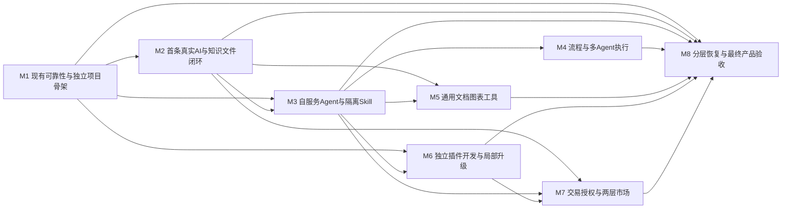

# AIJ 底座交付阶段与验收场景

对应[正式需求基线](REQUIREMENTS_BASELINE.md)与[源码差距](SOURCE_GAP_ANALYSIS.md)，基于 `b8eb9c2ecc4cca749c5dd1d38dc43489cda3a01c`。本轮完成的是文档规划项 REQ-20261105；M1至M8均为 PROPOSED_NOT_AUTHORIZED，不是已指派AF卡，不触发实现、厂商调用或发布。

阶段定义产品能力与出口；正式开发仍按单卡单Writer、一个可观察结果、允许路径、真实校验及≤4有效工程小时拆分。建议后续每批最多3小卡且不超过12有效工程小时，实际预算与卡片须由负责人明确。本文件不估造总工时或日期；超4h的能力先拆，不把下列整阶段伪装成一张卡。

## 一 依赖与阶段出口

| 阶段 | 目标 | 依赖 | 实施边界 |
| --- | --- | --- | --- |
| M1 | 现有可靠性与独立项目骨架：修复DELTA已知竞争/健康问题；复用私有pack与项目隔离，补通用初始化、基本身份治理和完整状态语义。先交外部可运行开发候选。 | 本轮基线及相关真实前置 | 不称完整AI标准版；独立消费前核对AF127及AF077..080必要接收门禁。 |
| M2 | 首条真实AI与知识文件闭环：DeepSeek/阿里云按能力分卡接入；七牛、文件解析、向量/重排与用户工作台；通知按渠道分卡逐个实测。 | M1 | 每个厂商/格式/渠道独立小卡；真实付费、收件人、预算另核验后执行。 |
| M3 | 自服务Agent与隔离Skill：个人/组织Agent资产、BYOK授权、工具策略、脚本沙箱和包校验、可管理记忆。 | M1, M2 | 先隔离与资源限制，再开放普通用户脚本；不修改现有unknown保护来凑自动重试。 |
| M4 | 流程与多Agent执行：可视化编辑和版本，分支/并行/循环/人工审核/子流程、多Agent及五入口统一触发，扩展任务中心。 | M3 | 复用RuntimeJob，不新建第二队列；外部副作用需幂等及结果未知处理。 |
| M5 | 通用文档图表工具：文档编辑、章节再生成与Word/PDF；可编辑数据图表和示意图、PNG/SVG及源码配置。 | M2, M3 | 页面编辑器、格式解析、每种导出分别验收；业务论文规则留行业插件。 |
| M6 | 独立插件开发与局部升级：完整插件SDK/模板/调试及可信包入口，迁移依赖校验，插件A维护时B持续可用。 | M1, M3 | 内部受信样例先跑通；第三方公开制品须先解决许可证和发布权。 |
| M7 | 交易授权与两层市场：真实支付渠道、对客计费退款、订阅/券/分账/结算，AIJ市场与产品市场及四种授权。 | M2, M3, M6 | 先交易唯一真值和授权，再上架收费；各渠道能力及商户准入分别确认。 |
| M8 | 分层恢复与最终产品验收：UI/CLI升级、整实例灾备、组织选择恢复与资源版本，保留周期和最终Linux制品全矩阵。 | M1, M2, M3, M4, M5, M6, M7 | M1起持续建设基础备份；M8关闭组织/资源恢复及全产品出口，不把备份推迟到上线后。 |

阶段依赖如下，节点表示建议交付阶段，不表示已启动的任务。

M2内不同厂商/格式/通知渠道，M5通用工具和M6插件SDK可按真实依赖安排不同批次；这不是本轮并行派工授权。主验收阶段是该条需求的目标出口，允许垂直切片提前建设依赖：例如M1短信登录先交付对应通知渠道，M2再关闭全部通知渠道目标；M1建立基本任务监控，M4再验步骤级任务中心；M1就建设整实例基础备份，M8完成三层恢复和最终演练。

每个阶段都交可运行、可观察的增量，不用空菜单替代能力。M1外部开发候选可运行不等于完整AI标准版成品；所有目标功能及全矩阵通过后才进入最终负责人验收。

## 二 建议的首批小卡候选

此表不分配正式AF号，不修改原队列。开工时将每卡允许路径、基线、资源、命令和实际预算冻结；若真实前置不满足，只执行不依赖它的获准项。

| 别名 | 单一结果 | 依赖和停止条件 | 需要的实际验证 |
| --- | --- | --- | --- |
| REL-HEALTH-01 | 给出runtime-readiness失败的确定状态快照并修复一个明确契约缺口 | 复用AF-126的DELTA-TEST-02与监控owner；先诊断，未确认根因不更改503断言 | 真实隔离DB/HTTP启动、故障、恢复；两个独立执行者及拒绝路径 |
| REL-FENCE-01 | 修复一个已复现的poll重入或文档生命周期竞争 | 从AF-126拆出一种竞争，不能跨两owner并发写；其他竞争独立后续卡 | 真实竞争/失效权限/停用边界，审计失败及回滚按适用范围验证 |
| GEN-REVIEW-01 | 沿用AF-131核定外部消费路径及缺口，给出下一张独立初始化小卡 | 原AF-131、AF-127、AF-077..080必要接收门禁按真实记录处理；未解除时仅可做获准只读预审 | 不将四配置文件或源库run-app当仓库外可运行；不重复建立同一AF或OrcaRun |

这三项均尚未授权实施；GEN-REVIEW-01并非当前就绪实现卡。后续不是整批重做旧AF，而是在唯一owner内复用、补缺及验证。

## 三 可操作验收场景

以下场景状态全部为 NOT_RUN_TARGET_ACCEPTANCE。历史验证只作基线证据；每场景记录实际制品版本/摘要、配置归属、时间、操作者、命令及退出码、API路径/状态和浏览器证据，秘密不进报告。模拟Provider只证明协议逻辑；真实厂商、商户和通知渠道分别以批准的小额/合成数据现场验证。

| 场景 | 对应需求与阶段 | 成功路径 | 必须拒绝或保护的路径 |
| --- | --- | --- | --- |
| AC-001 | REQ-001 / M1 | 在仓库外两个空目录独立安装同版制品并启动，业务数据/附件各归项目。 | A有效会话用于B被拒；不允许链接宿主源码、node_modules、上传目录或复用库。 |
| AC-002 | REQ-002 / M1 | 三种组合生成可运行宿主；标准版提供已实现AI入口及准确待配置状态。 | 未实现能力不能伪装待配置；未知插件、缺依赖或跨项目配置拒绝。 |
| AC-003 | REQ-003 / M2 | 普通用户从工作台提交/查看同一API任务；独立前端消费SDK获得相同权限结果。 | 匿名/无权限/其他成员访问任务被拒，UI隐藏不能替代API授权。 |
| AC-004 | REQ-004 / M1 | 通过正式页面/API完成建号、授权、只读查询和目标审计。 | 合法会话正确CSRF写403且数据不变；撤权后下一请求拒绝。 |
| AC-005 | REQ-005 / M1 | 客户用两种已配置方式登录，停用/改密后旧会话失效，身份关联规则明确。 | 错误/过期/重放验证码、撞库、跨产品Token均拒绝，发码受限流。 |
| AC-006 | REQ-006 / M1 | 同一成员在两个组织具有不同角色，个人资源及任务保留原归属。 | 客户端自报workspaceId不授予权限；停用成员/角色立即失效。 |
| AC-007 | REQ-007 / M3 | 已授权工具执行；需人工确认的写操作停在审批点，审计可关联。 | 批准后撤权、换组织或变更工具版本不能沿用旧审批执行。 |
| AC-008 | REQ-008 / M2 | 个人/组织通过同一接口上传下载，两种存储实现同一访问策略并校验内容摘要。 | 猜测对象key、跨组织/过期链接和越权公开私有附件被拒。 |
| AC-009 | REQ-009 / M2 | 每类格式形成可追溯文档/版本；网页更新按版本入库，业务来源记录授权主体。 | 恶意文件、SSRF网址、越权业务API和解析失败不污染已发布知识。 |
| AC-010 | REQ-010 / M2 | 基于合成数据检索命中预期来源，回答可打开对应文件或业务记录。 | 跨组织引用为0，无依据明确拒答；更换向量模型不能混用旧向量索引。 |
| AC-011 | REQ-011 / M2 | 按能力矩阵对两家可用模型执行真实小额成功/失败/用量样例。 | 不兼容能力不能只改URL冒充支持；模型不可用状态有明确原因。 |
| AC-012 | REQ-012 / M3 | 两个组织和个人分别使用授权配置，产品允许的模型可被客户端选择。 | 其他组织密钥不可读/不可借用，脚本/日志/导出只含引用不含值。 |
| AC-013 | REQ-013 / M3 | 限流/已确认失败按策略切换，并展示实际模型、付款来源和消耗。 | 结果未知不得盲目重发；切空间不转移付款方；超预算不启动新调用。 |
| AC-014 | REQ-014 / M7 | 10元预占、3元可计费时实扣3释放7；关联唯一任务/调用/来源与价格。 | usage缺失保持待核对而非零成本；重放和并发不重复扣费或双花。 |
| AC-015 | REQ-015 / M3 | 三个归属层能创建私有Agent并在授权范围共享/运行，运行保留版本快照。 | 未发布/被禁用/依赖失效Agent不能执行；旧快照不能绕过当前撤权。 |
| AC-016 | REQ-016 / M3 | 上传能力包通过校验，在隔离执行器处理已授权文件，输出可下载且可审计。 | 脚本越权网络/文件/凭据、超时/内存/并发超限被拦截，不在API进程运行用户代码。 |
| AC-017 | REQ-017 / M4 | 规划/执行/评审Agent在任务图中分工，前后结果与成本可追踪。 | 交接不能扩大数据权限；被取消分支不继续产生工具副作用。 |
| AC-018 | REQ-018 / M3 | 跨会话读取获授权记忆，修改/删除和撤销Agent授权即时生效。 | 被删除或其他组织的记忆不得通过缓存、检索和恢复重新注入。 |
| AC-019 | REQ-019 / M4 | 编辑、验证、发布含脚本/Agent/审批的流程，查看各步骤结果并继续执行。 | 循环与分支有边界；无权限、错误连线、缺依赖、过期审批拒绝发布或执行。 |
| AC-020 | REQ-020 / M4 | 五入口对同一发布流程生成可关联任务，参数与调用主体明确。 | 重复Webhook/事件/调度不重复收费或产生外部动作，验签失败不入执行队列。 |
| AC-021 | REQ-021 / M1 | 两个独立执行者竞争同一任务仅有效租约执行；故障可见并恢复，后续M4显示步骤。 | 旧租约/重入/停用期间写入和结果未知重试均拒绝，不能用历史PASS覆盖失败。 |
| AC-022 | REQ-022 / M5 | 编辑正文后重生成指定章节，显示差异并导出可打开且排版可读的Word/PDF。 | 并发编辑与AI重生成不得静默覆盖用户修改；导出越权资源被拒。 |
| AC-023 | REQ-023 / M5 | 以已知数据生成图表、网页改数据重绘并导出PNG/SVG，统计值与来源一致。 | 示意图片不能冒充数据计算图，未授权数据/脚本及恶意SVG不可执行或外泄。 |
| AC-024 | REQ-024 / M6 | 独立插件目录开发最小完整业务模块，安装到兼容消费者，无内核业务改动。 | 未签验/未知包/不兼容依赖或非法命名空间拒绝，不把manifest声明当真实页面/API。 |
| AC-025 | REQ-025 / M6 | 插件A升级中停用，插件B业务读写/任务继续，A恢复后数据及授权可核对。 | 失败升级不污染B；停用A后导航移除且直接API拒绝；未知恢复能力不承诺任意回滚。 |
| AC-026 | REQ-026 / M7 | 市场发布版本经审核后授权安装到指定产品或组织，个人可购买获准AI资产。 | 用户购买不能获得后台代码安装权限；市场不可读取消费者业务库/密钥。 |
| AC-027 | REQ-027 / M7 | 同一商品按所选授权范围开通并计次/到期，使用与退款可追溯。 | 复制许可证到其他实例/组织、重放回调和伪造次数均不能扩权。 |
| AC-028 | REQ-028 / M7 | 按商户能力完成小额下单、回调、查询、退款与对账，权益基于核实交易。 | 伪造签名、金额/币种/商户/应付对象不一致与重复回调拒绝或幂等。 |
| AC-029 | REQ-029 / M7 | 授权后续费，到期前提醒；关闭后不再发起后续扣款，账期权益可查。 | 无有效授权/不支持渠道不得伪造自动续费；超时不重复扣款。 |
| AC-030 | REQ-030 / M7 | 符合规则的订单锁券、核销或失败释放，与退款规则关联。 | 并发重复核销、跨商家券和篡改客户端价格被拒。 |
| AC-031 | REQ-031 / M7 | 合成/获准真实小额交易完成分账结算并核对金额来源。 | 未支付/已全退/超可分账金额不执行，不承诺所有渠道同等能力。 |
| AC-032 | REQ-032 / M7 | 核对平台故障、中途取消、现金余额和赠额分开处理，原路退款状态可核实。 | 补偿/退款重复请求不重复退；退款未核实不能记成功，旧流水不覆盖。 |
| AC-033 | REQ-033 / M2 | 各适配渠道以已批准测试收件人完成发送并展示真实投递/失败状态；M1先打通短信登录所需渠道。 | 枚举和mock不能当投递成功；撤权、错组织、重复事件和未知结果不重复投递。 |
| AC-034 | REQ-034 / M8 | 干净Linux主机按文档安装，UI与CLI生成同一升级计划、校验和及回执。 | 不可用制品、越权/任意命令、错误数据库或无法恢复的变更被阻止。 |
| AC-035 | REQ-035 / M8 | 在新隔离目标实际恢复全部数据/文件/授权，比较摘要并恢复服务。 | 只有备份文件没有恢复不算通过；缺对象/错版本/损坏归档明确失败。 |
| AC-036 | REQ-036 / M8 | A组织恢复到已验证点，B保持业务读写；A数据、文件和依赖完整。 | 跨组织引用、恢复点后的新修改和全局记录覆盖不自动合并，保留现状/副本/逐项选择。 |
| AC-037 | REQ-037 / M8 | 指定资源恢复历史版本并形成新版本，运行仍能引用原冻结版本。 | 不复活已撤销会话、密钥、权限和被删除记忆，不自动重放通知/扣款/任务。 |
| AC-038 | REQ-038 / M8 | 按可控时钟验证到期清理、引用固定、有效恢复点显示及删除标记的恢复处理。 | 数据库/附件未共同验证的点不可选；清理不删除有效购买/安装/任务引用版本；财务审计不套草稿期限。 |
| AC-039 | REQ-039 / M1 | 端到端任务的配置/Run/Trace/Job/交易引用可关联，入口与执行时均按当前权限复检。 | 伪造上下文、旧权限快照、上游成功未知和重复消费者不得制造第二份真值。 |
| AC-040 | REQ-040 / M1 | 新鲜候选制品跑成功/拒绝/恢复路径，人工操作能重现，运行状态与依赖实际一致。 | 旧报告、descriptor、配置VALID、页面HTTP200不能替代产品通过；失败不改断言伪绿。 |

## 四 重点跨模块验收

1. 新项目A/B消费同一最终制品，独立依赖/DB/账号/密钥/上传目录。管理员登录、建普通用户、授权、文件和AI调用可操作；A凭据、资源和授权不能用于B；直接API与按钮行为一致。
2. 同一用户个人空间和两个组织有不同权限。发起Agent/Skill/记忆/任务后切换空间，原任务的付款、数据和权限归属不漂移；撤权后执行器重新检查。
3. 用户上传脚本Skill，经隔离执行器处理获准文件。越权网络、读宿主文件、探测密钥、无限循环与超资源被拒；Agent自主计划和多Agent交接不会获得更高权限。
4. BYOK调用出现已确认可切换失败，未授权跨付款来源则暂停；授权后只使用白名单候选和剩余预算。外部结果未知保持待核对。三次尝试/一次切换边界、取消、迟到回执与重放不重复收费。
5. 预占10元、可计费3元，核对实扣3元、释放7元；平台故障退费与上游成本分别记录。充值/券/订阅/授权重放、退款未成功、分账后退款都按唯一交易事实处理，不用模拟资金流程宣称商户验收。
6. 独立业务插件A安装/启停/升级时，B的读写与在途任务继续；A数据/迁移/授权与兼容报告可核对。未获许可制品不公开发布，未知代码不通过manifest路径动态执行。
7. 文档人工编辑与AI局部再生成发生竞争时，保留当前版本并展示差异；Word/PDF用真实阅读器渲染检查，图表用已知数据核对数值、来源、网页修改和导出字节。
8. 整实例恢复到新目标后核对文件摘要及权限；组织A恢复只暂停A，组织B持续成功。默认新版本/副本，遇新修改/跨组织依赖停止自动覆盖；支付与外部投递不重复执行，已撤销会话/密钥不复活。
9. 可控时钟覆盖7天恢复窗口、15分钟目标间隔及30/90/180天、12个月保留边界；有效引用版本不清理，已删除数据标记在恢复后继续生效。UI不展示未经完整校验的恢复点。

## 五 每张正式卡的验证与交接

- 写前核对目标卡、branch/status/HEAD/remote及Writer；不同卡共享文件/数据库/重型构建由总控串行调度。
- 在注册verify:task中执行当前实现的成功、拒绝、故障和恢复路径；涉及页面有实际浏览器操作，涉及格式导出有渲染，涉及厂商有获准真实回执，涉及备份必须真实恢复。
- 测试库/项目/端口保护先通过。未知进程不停止，既有AF-029及持久Base实例不接管。现有端口遵守仓库及专项profile，本轮不新增运行地址。
- 记录实际diff及DB/API/页面/权限/日志影响、未实现、失败历史、秘密本机路径、启动是否真实、人工步骤和下游依赖。自查不冒充独立Review。
- 正式卡通过后按队列原标题精确本地提交；push、部署、商户资金、公开分发等按负责人实际授权，未获授权不执行。批次出口OWNER_CHECK_PENDING，不从CODE_VERIFIED代签接收。

## 六 完成条件与下一动作

完整目标以40条需求及40个场景全部有对应新鲜制品证据、未解决差量明确关闭、相关来源/许可已核查、负责人验收记录明确为出口。先前阶段成功不能替代最后候选，最终源码变化后定向重验受影响场景。

本轮交付后由负责人审阅基线、待定项和阶段依赖，再选择明确的小卡批次。O01至O08只阻断真正依赖该输入的卡；不停止可独立完成且已授权的工作，不通过改旧队列隐藏失败或永久等待。形成计划不等于授权执行M1至M8。
