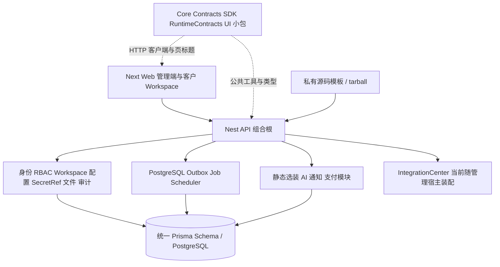
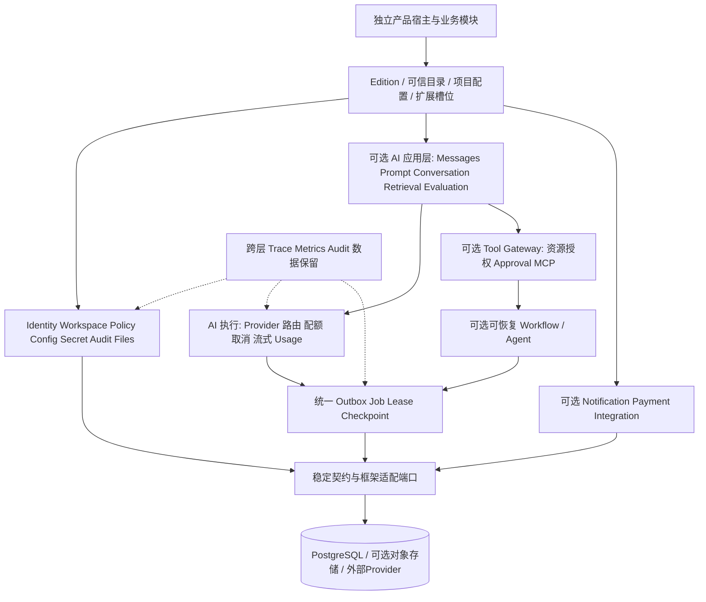

# AIJ Foundation 全仓架构与阶段分析报告

评估日期：2026-11-04。代码基线：`dev@5bd33fdbf30306d56d38525e665daa2cd0bf2fbd`。

[优化任务清单](../planning/AIJ_FOUNDATION_OPTIMIZATION_BACKLOG_20261104.md) · [机器可读任务](../planning/AIJ_FOUNDATION_OPTIMIZATION_BACKLOG_20261104.json) · [证据快照](AIJ_FOUNDATION_ARCHITECTURE_EVIDENCE_20261104.json) · [上一轮交付记录](REMAINING_DELIVERY_REVIEW_20261104.md)

## 1. 阶段判断与建议

**当前已经具备通用业务底座的实质基础，适合继续承载受控研发和参考产品试点。整体阶段建议定位为“模块化单体 Alpha / 可运行参考实现”，还没有达到多产品稳定复用、可独立升级、可对外生产运行的成熟通用 AI 开发底座。**

保留现有 NestJS、Next.js、PostgreSQL、Prisma 与模块化单体方向是合理的。身份、权限、租户、配置、密钥、文件、审计和异步执行有真实实现与拒绝路径，这些正是 AI 应用也需要的基础。下一阶段的主要工作应转向组合根一致性、可靠执行、正常新项目交付、稳定扩展契约及运行治理，然后建设可选择的通用 AI 应用层。

AI 当前覆盖服务端模型执行、Trace、内部预算、知识检索/问答与评测快照；它仍围绕一个知识问答场景和一个真实 Provider 适配展开。多模型路由、可版本化 Prompt/对话、受控工具调用、MCP、可恢复 Agent/Workflow 尚未形成产品能力。

本次对“AI 时代通用底座”的工作假设是：**多个独立业务产品共用稳定的工程/身份/租户/运行能力，按需选装 AI 与工具编排，新增业务拥有自己的规则和数据。** 未把插件市场、可视化工作流或大量 Provider 作为所有项目的默认要求。

### “AI时代”需要同时满足两种能力

- **开发方式层**：让人和编码Agent能快速理解owner、稳定API/权限契约、可声明的模块与可复现验证；新增业务少改核心，升级有明确边界。当前任务文档较多，但能力状态/硬编码目录分散，需要先提高机器与人读取的一致性。OPT-006/007/008/010/011主要解决这一层。
- **产品能力层**：应用按需获得模型执行、路由/预算、知识/评测、受控工具与可恢复编排。Agent/MCP/可视化工作流属于具体产品选项，不应成为所有普通业务应用的强制依赖。OPT-018～025主要解决这一层。

底座的长期价值应体现为新产品启动、领域功能接入和升级维护的成本可控；仅增加模型或Agent功能数量不能证明通用性。

### 当前能支撑什么

| 使用目标 | 判断 | 需要满足的条件 |
| --- | --- | --- |
| 内部管理系统、独立业务项目的研发起点 | 可以支撑受控试点 | 接受当前技术栈；先修复本报告的租约、插件与入口一致性问题 |
| 带 Workspace、权限和后台的早期 SaaS | 基础能力可复用 | 公共注册/找回需接通实际通知；补齐生产配置、观测、容量与版本接收 |
| 小型文本知识助理 | 已有最小闭环 | 目前以离线合成评测为证据；真实 DeepSeek 仍受上游确认、预算与凭据条件约束 |
| 多产品长期依赖、统一补丁升级的底座产品 | 尚需产品化 | 形成稳定扩展边界、独立消费者和版本升级路径，控制 source-template 分叉成本 |
| 通用 Agent、Tool、MCP 与多步工作流平台 | 当前能力不足 | 需要受控工具网关、批准、持久状态、恢复与预算/权限传播 |
| 面向客户的正式生产发行 | 本次证据不足以确认 | 一致性修复、生产模拟、关键链路/容量/恢复验证与负责人接收通过 |

上一轮 AF-116～AF-120 解决了已列明的具体开发闭环并通过相应校验。本次加入多产品复用、真实装配路径和生产运行口径，发现了原卡片回归没有覆盖的跨模块问题；原有通过记录仍按其实际范围保留。

## 2. 评估方法与证据范围

本次执行全仓目录/职责/依赖扫描，重点追踪组合根、身份授权、Workspace、插件生命周期、异步任务、AI/知识、文件、配置/SecretRef、SDK、生成/打包与验证入口；通过定向探针复现关键问题。它是阶段与架构评估，未将每个源码行等同一次安全审计，也未执行生产压测。

本次现场统计：API `src` 下170个文件、约10,953行；Web `app` 下46个文件、约2,507行；Prisma 50个模型、21个枚举、22次迁移；5个窄职责 `@aij/*` workspace 包。统计排除 AppleDouble、依赖和构建输出，用于说明审查对象，不用于推算完成百分比。

本轮新运行：`pnpm test` 根测试84/84、API测试8/8；`pnpm --filter @aij/api build` exit0；重新构建后5项定向观察全部复现。涉及持久化的探针只使用本库随机新建的 AF-120 隔离 test 验收库、合成数据和临时 loopback HTTP，未调用外部 Provider、未写共享/正式数据库。临时应用已关闭，测试库保留。

既有证据：上一轮 AF-120 的50/50结构化目标测试、Prisma、API/Web构建、lint/typecheck与私有包消费通过，见原交付摘要。本轮没有重跑全部历史任务卡、全部浏览器操作或所有外部接入。**观察脚本“运行成功”表示已复现报告描述，并不表示被观察行为已符合目标。**

## 3. 当前架构及可保留的基础

以下设计方向建议继续保留：

- 组合根、Controller/Service/DTO/Guard 与具体模块职责明确；采用模块化单体能够支持当前规模，没有证据要求立即拆为微服务。
- 管理员、客户与 Workspace 成员身份区分；Workspace header 经过认证和服务端成员/权限校验，不能由客户端自报完成授权。[Guard](../../apps/api/src/client-workspaces/workspace-context.guard.ts#L18)、[成员上下文](../../apps/api/src/client-workspaces/workspace-context.service.ts#L11)
- 管理写操作在事务内重新授权；Cookie/CSRF、跨产品凭据和拒绝路径已有实现。扩展时应复用这些安全边界。[管理写入口](../../apps/api/src/rbac/management-access.service.ts#L21)、[浏览器会话](../../apps/api/src/auth/browser-session.ts#L7)
- Job/Outbox、失败分类、重试/死信、运行记录和 SecretRef 有唯一 owner；AI/支付/通知没有把账本无限复制。外部未配置时默认拒绝具有实际价值。
- 本地运行的数据库、凭据、存储与旧产品隔离保护较细；保留这些开发/验收保护，再单独设计生产模式。
- 已有真实 DB/HTTP、拒绝/恢复、私有包与迁移检查。继续补齐长期产品回归，能够复用这些既有投入。

## 4. 能力与成熟度矩阵

| 能力域 | 当前实际实现 | 主要缺口 | 阶段判断 |
| --- | --- | --- | --- |
| 工程装配 | pnpm monorepo、API/Web、依赖锁定、本地环境与构建 | 多 edition 的统一配置及生产运行契约 | 本地可运行 |
| 管理身份 / RBAC | 登录、会话失效、角色权限、菜单、管理审计与页面 | 企业认证、MFA及跨产品稳定契约需按目标补齐 | 核心闭环较完整 |
| 客户 / Workspace | 独立身份、成员角色、服务端租户上下文、权限与成员管理 | 邀请模型/流程、SSO与资源授权扩展尚未提供 | 可支持基础多租户 |
| 配置 / SecretRef | 分层配置、版本约束、env/local引用、轮换/清除、敏感投影 | 外部密钥托管、生产运行注入和规模治理 | 本地治理基础可用 |
| 文件 / 审计 | 本地真实字节存储、鉴权、校验、删除恢复、去敏审计查询 | 多实例存储选择、统一跨域保留策略 | 本地闭环可用 |
| 异步执行 | 持久任务/Outbox、领取锁、幂等表、重试/死信、调度 | 已确认租约接管准入问题；独立worker、容量和健康语义不足 | 生产前需修复 |
| 插件扩展 | 静态可信注册、版本/依赖、安装启停、升级/失败操作记录 | 目录多源、门禁不一致、权限/菜单/任务元数据仍分散 | 契约存在，组合需收敛 |
| Integration | 单个可信入站 webhook connector、验签/重放/操作记录 | 目前不足以作为通用连接器/API Key/Tool/MCP平台 | 特定协议闭环 |
| 通知 / 支付 | 通知intent/attempt/inbox、支付轨道/回调/申请/对账与合成Provider | 真实通知与资金轨道未接入；客户身份通知没有复用完整交付链 | 离线边界明确 |
| AI执行 | Provider端口、能力开关、异步执行、Trace、预算、DeepSeek适配 | 消息/流式/多模型路由、周期配额、稳定Prompt/会话协议 | 单场景AI执行MVP |
| 知识 / 评测 | 文本导入、词项匹配、引用/拒答、20例离线评测、七天清理 | 语义检索/版本索引、真实质量评估、版本化评分和规模回归 | 小型文本知识闭环 |
| Agent / Tool / Workflow / MCP | 没有对应通用实体、注册和执行闭环 | 工具授权、批准、状态/恢复、协议适配和预算传播 | 未形成能力 |
| 包 / SDK / UI | 5个真实窄职责包及私有包消费；SDK是通用fetch包装，UI主要为PageHeading | 大部分底座实现仍在apps/api；新领域接入与升级边界需验证 | 可复制工程强于模块产品 |
| 发行 / 运维 | 私有源码模板与安装/恢复历史验证；本机开发/测试Compose | 干净CI、生产容器/配置、稳定版本、容量/观测和负责人接收 | 受控研发阶段 |

## 5. 已确认的一致性与可靠性问题

### F01 / P1：编排任务租约接管后可重复进入副作用处理函数

在同一逻辑任务上先取得旧claim，模拟其租约到期，再由新worker取得claim；随后让两个claim并行执行。**合成handler被调用2次。** 没有外部网络动作。探针是确定性的租约到期/接管模拟，展示准入与重入问题，不是吞吐压测。

`executeOrchestrated` 对幂等记录只在 completed 时重放；遇到 processing 继续执行。进入handler之前没有将当前租约 owner/attempt 作为准入条件，所有权检查主要发生在handler完成后的数据库提交阶段，已经晚于外部副作用。[领取与入口](../../apps/api/src/async-runtime/job.service.ts#L172)、[幂等与handler](../../apps/api/src/async-runtime/job.service.ts#L293)、[完成后所有权检查](../../apps/api/src/async-runtime/job.service.ts#L339)

优先补执行准入、租约/attempt fencing与外部幂等/不确定结果策略。即使加入fencing，也不能撤回已经发出的外部请求；需要由工具/Provider的幂等能力或对账策略处理。当前不能据幂等表承诺外部副作用恰好一次。对应 **OPT-001**。

### F02 / P1：AI启动注册与默认插件管理catalog不一致

实际运行注册有 `aij-ai/aij-notification/aij-payment`，默认管理catalog只有通知和支付；直接查询AI注册失败。已有测试夹具通常直接创建AI安装行，掩盖了“新项目通过正常管理入口安装AI”的路径断层。[运行注册](../../apps/api/src/plugin-runtime/plugin-runtime.module.ts#L11)、[管理目录](../../apps/api/src/plugin-runtime/plugin-management.module.ts#L13)

应由单一可信注册源生成启动、管理和生命周期视图，补正常安装/启停回归。对应 **OPT-002**。

### F03 / P1：插件停用状态没有覆盖旧知识接口

在合法同Workspace客户会话下，将AI安装状态改为 `installed`（未启用）：手工文档创建返回201，列表和检索返回200，仍能获取检索来源；文件导入和新评测已有部分启停检查。`createDocument`只在带导入来源参数时使用生命周期检查，旧创建/查询链主要做成员权限检查。[创建入口](../../apps/api/src/plugins/aij-ai/ai-knowledge.service.ts#L104)、[检索入口](../../apps/api/src/plugins/aij-ai/ai-knowledge.service.ts#L252)

本复现证明插件停用契约不一致，**没有证明跨租户泄露**。需覆盖全知识API、菜单和后台执行，区分启动加载与数据库启用状态。菜单可用性目前也主要取启动配置，需一起核对。[菜单可用性](../../apps/api/src/menus/menu-availability.service.ts#L6) 对应 **OPT-003**。

### F04 / P1：运行时readiness忽略心跳过期和错误

将worker/scheduler标为running、最后轮询时间设为1小时前，并给worker设置错误，在数据库探针正常的条件下，`RuntimeHealthService.snapshot().ready`仍为true。这影响 `/api/admin/runtime/readiness` 的运行时健康判断；`/api/ready`目前明确只检查数据库，不应混为同一能力。[健康实现](../../apps/api/src/async-runtime/runtime-health.service.ts#L12)、[管理readiness](../../apps/api/src/async-runtime/runtime-admin.controller.ts#L15)、[数据库readiness](../../apps/api/src/ready.controller.ts#L8)

应定义角色所需的心跳新鲜度、宽限、degraded与恢复标准。对应 **OPT-004**。

### F05 / P1：新项目生成尚未交付ai-standard正常路径

生成器只接受 `profile=aij-base`；其验证路径明确拒绝非空 `ENABLED_PLUGINS`。本次生成一个独立项目，再通过正常项目配置启用AI，`show`按现有base规则拒绝。这里首先是缺少AI edition的产品能力，base默认空插件本身合理。[profile校验](../../scripts/project/cli.mjs#L150)、[环境校验](../../scripts/project/cli.mjs#L215)

需增加显式ai-standard及配置/依赖/凭据传递契约，而不能让用户跳过生成器、手工补数据库。当前allowedLocalEnv也没有AI预算/Provider门禁变量，需整体设计。[配置allowlist](../../scripts/project/cli.mjs#L10) 对应 **OPT-005**。

## 6. 通用底座目标下的结构性缺口

### F06：公共客户身份流程的真实通知尚未闭合

客户验证/找回适配器只有disabled/test，test把令牌放在内存投递列表；生产不可用。通知运行模块的外部Provider registry也为空。现有能力可以支持测试和受控账号准备，不能将其等同实际邮件验证/找回送达。[客户适配器](../../apps/api/src/client-auth/client-auth-notification.adapter.ts#L12)、[通知运行模块](../../apps/api/src/plugins/aij-notification/notification-runtime.module.ts#L7)

开放自助注册前，应复用已有通知owner完成真实协议/本地可观察交付。支付的生产Provider为空是已声明的离线范围，不要求为通用base强行接入真实支付。对应 **OPT-016**；支付按业务需要独立接入。

### F07：模块化单体具备结构，插件与复用产品边界尚未完全实现

API组合根在auth+database时直接装配IntegrationCenter；Workspace核心权限常量包含支付/知识权限；AI manifest中的permissions/routes/jobs/migrations等声明为空，但实际模块有接口、权限和任务。增加新系统插件仍会触及若干核心列表。[组合根](../../apps/api/src/app.module.ts#L35)、[权限常量](../../apps/api/src/client-workspaces/client-workspace-permissions.ts#L1)、[AI manifest](../../apps/api/src/plugins/aij-ai/ai-plugin.ts#L5)

五个包有真实消费和价值，但主要覆盖关联ID、成功包络、HTTP客户端、运行类型和页标题；身份/租户/配置/队列等实现仍位于apps/api。`@aij/base`通过私有源码模板分发整个工程，能提供独立副本，同时带来后续分叉和补丁合并成本。[包边界](../development/PACKAGE_BOUNDARIES.md)、[源码打包范围](../../scripts/distribution/pack-aij-base.mjs#L17)

建议先统一声明和公开扩展契约，用两种真实需求参考应用测出耦合，再抽稳定实现包。暂不要求一次性拆全部包、全部Prisma Schema或微服务。对应 **OPT-007/009/011**。

### F08：AI仍是单场景执行层，尚未具备通用AI应用/Agent抽象

现有能力码只有text.generate；Provider配置只选择项目级provider/model/credential；DeepSeek适配只接受query/evidence，固定Prompt、非流式并禁止工具动作。预算针对单次评测和固定模型/价格版本，安全但不足以承担日常租户周期配额与多模型策略。[Provider协议](../../apps/api/src/plugins/aij-ai/ai-provider.ts#L5)、[选择配置](../../apps/api/src/plugins/aij-ai/ai-configuration.ts#L14)、[DeepSeek请求](../../apps/api/src/plugins/aij-ai/deepseek-provider.ts#L26)、[预算策略](../../apps/api/src/plugins/aij-ai/ai-evaluation-budget.service.ts#L8)

未见通用Prompt版本、Conversation、ToolInvocation、Approval、AgentRun、WorkflowRun等实现闭环。通用AI层应允许业务项目注册自己的能力和工具，但由服务端验证身份、资源、预算和批准；模型文本不能授予权限。先补协议、路由、会话和评测，再考虑工具/编排。对应 **OPT-018/019/020/022/023/024/025**。

### F09：知识检索与评测只证明小型文本闭环

当前按词项包含度筛选候选，最多读取500条，再在内存排序；没有向量、分块索引、rerank或版本化摄取管线。50KB txt/md导入和来源引用是有效起点。现有20例数据为合成词项/答案标记，离线Provider直接使用证据生成结果；18/18答案和2/2拒答不能外推为真实DeepSeek语义质量。[检索策略](../../apps/api/src/plugins/aij-ai/ai-knowledge-retrieval.ts#L1)、[候选查询](../../apps/api/src/plugins/aij-ai/ai-knowledge.service.ts#L262)、[样本](../../scripts/verification/g19-knowledge-evaluation.cases.mjs)

新增评测快照保存实际输入/输出与状态，尚不等于版本化数据集/评分器/回归比较平台。先固定检索、引用、groundedness与租户隔离基线，再以需求和实测选择全文/混合/向量方案；不必立即引入独立向量数据库。对应 **OPT-021/022**。

### F10：本地保护、持久化基础与生产运维仍有距离

数据库URL校验目前强制loopback；API监听固定127.0.0.1；仓库只有本地开发/测试PostgreSQL Compose。Prisma连接池固定1、2秒连接/池超时，管理写还使用全局管理写锁。worker/scheduler与API同进程运行，并批量领取后顺序处理。它们是当前保护/简化选择，也需要生产配置、容量和长任务租约验证。[环境约束](../../scripts/runtime-environment.cjs#L78)、[Prisma参数](../../apps/api/src/prisma/prisma.service.ts#L21)、[worker](../../apps/api/src/async-runtime/runtime-worker.service.ts#L20)

本次未见仓库中的应用生产容器、端到端OpenTelemetry/指标告警或生产SLO证据；文件实现为本地adapter。需要单独定义生产模式和部署拓扑，保留dev/test保护；再按多实例需求增对象存储及独立worker。对应 **OPT-012/013/014/017**。

### F11：稳定发行与默认消费者入口没有接收成形

本轮实时 `git ls-remote --symref origin HEAD refs/heads/main` 返回默认HEAD为main，且main仍是初始化提交 `00f0ae9`；实际实现均在dev。本地未见版本tag，现有包均private/0.1.0。直接按默认分支获取工程，无法得到当前能力。稳定分支、tag、许可、渠道和平台支持仍需负责人明确接收。

仓库内未见 `.github` CI workflow。已有私有源码包/离线安装/升级恢复的实测资产应保留，但需与稳定版本、兼容矩阵和可复现生产候选结合。对应 **OPT-006/015/028**。本次不自动改默认分支、合并main或发布包。

### F12：任务级证据丰富，长期验证和当前文档存在负担

默认 `pnpm test`只运行基础scripts测试和API test，并不等于全部238个验证目录文件被运行。部分卡片前置依赖忽略目录中的历史baseline和固定HEAD，适合卡片证据，不适合直接作为干净clone的长期CI回归。新的预算并发测试使用同一个Prisma实例，而其连接池固定1；Promise.all不能替代独立进程/连接竞争验证。[默认命令](../../package.json)、[历史卡前置](../../scripts/verification/registry.mjs#L770)、[预算用例](../../scripts/verification/ai-evaluation-budget.test.mjs#L24)

registry约5,476行，队列JSON约11,872行，CURRENT_STATE约1,309行。ARCHITECTURE/RELEASE_PROFILES仍混有“未迁入”“注册表为空”等旧快照，与当前源码冲突。需要当前状态与历史归档分离、可生成/校验的能力表、分域验证注册。[架构文档](../current/ARCHITECTURE.md)、[发行文档](../current/RELEASE_PROFILES.md) 对应 **OPT-006/008**。

### F13：企业身份、资源授权与AI数据治理需按应用场景补齐

Workspace授权基础有效，但Schema明确未纳入邀请；尚无SSO/MFA通用实现。新增工具调用、后台任务、导出和检索索引需要相同的服务端scope与资源边界，不能只靠页面或入参workspaceId。现有应用层检查不是“没有租户隔离”，也不能自动保证所有未来实体安全。

建议scoped repository/复合约束、跨角色/跨租户负例和各数据owner留存规则先落地，再评估数据库RLS。RLS需要验证数据库角色、owner绕过和连接池事务上下文，不是打开开关即可完成隔离。对应 **OPT-023/024/026/027**。

### F14：开发者体验需要从通用fetch包装演进为稳定契约

当前SDK维护HTTP请求/凭据/包络检查，主要API DTO与页面数据仍由各宿主持有；UI包只有PageHeading等窄能力。它们不构成完整领域SDK/设计系统，这本身不妨碍当前应用，但多产品扩展时需要减少手写平行类型、重复权限与页面装配逻辑。[SDK](../../packages/sdk/src/index.ts)、[UI](../../packages/ui/src/index.ts)、[后台壳](../../apps/web/app/components/admin-shell.tsx)

应按真实消费者增加版本化API契约/生成客户端与扩展槽位，再决定共享表单、权限控件和导航能力；不要求重做现有UI风格。对应 **OPT-009/010/011**。

## 7. 建议的目标架构

推荐边界：

1. **通用底座层**只提供工程装配、身份/租户/策略、配置/密钥/文件/审计与可靠运行端口；业务订单、权益、顾问和领域Prompt仍归产品。
2. **AI应用层**负责版本化请求/提示/对话/知识与评测，Provider和外部协议是可替换适配，内部预算与Provider实收成本保留不同真值。
3. **Tool层**强制身份、Workspace资源、动作风险与批准；MCP只是工具接入协议之一，复用统一策略与审计。
4. **Workflow/Agent层**表达多步状态/恢复与等待，复用既有Job/Outbox；不要同时建设第二套异步运行时。
5. **交付层**先支持显式base/ai-standard与稳定契约，用差异化消费者验证升级；模块化单体维持当前开发效率，只有实测瓶颈或部署隔离需要时再拆独立服务。

## 8. 优化路线与投入选择

已生成 **28项候选优化工作包**，每项包含owner、依赖、范围、可判定验收、适用条件和初步估时。全部标为待规划/未授权实现，没有分配正式AF编号，不会自动续跑。

| 阶段 | 主要结果 | 候选有效工时 | 建议 |
| --- | --- | ---: | --- |
| M0 | 租约、目录、门禁、健康与当前状态一致 | 13–25h | 优先处理 |
| M1 | 生成/安装/扩展/升级可复用，两个参考产品证明边界 | 52–84h | 逐步形成底座产品 |
| M2 | 所选范围的生产配置、容量、观测、必要适配与发行接收 | 64–106h | 按真实上线目标裁剪 |
| M3 | 通用AI协议、路由配额、Prompt/对话、检索与评测 | 56–96h | 依据首个AI产品选择 |
| M4 | Tool/批准、MCP、可恢复Workflow/Agent | 44–74h | 明确需要工具/Agent时再做 |
| M5 | 企业SSO/MFA/邀请增强 | 12–24h | 目标企业客户驱动 |

完整候选路线合计241–409h，含多个条件性能力，不应当成“现在必须继续开发的全部剩余工作”。估算为单Writer有效工程小时，含实现、目标验证与常规修正，不含外部确认/凭据等待、正式环境操作或交付日期；开卡时仍需复核范围，超过4h拆卡。阶段之间有跨依赖，按任务清单执行，而非按数字机械推进。

**建议下一次先处理OPT-001与OPT-002，再处理OPT-003/004，收敛OPT-008。** 在此基础上补生成器与干净CI，即M0 + OPT-005/006，候选27–47h，可取得更完整的首条试点路径。随后用参考产品暴露真实复用成本，再决定包抽取、生产发行和AI高级能力。首批OPT-001/002估计6–12h，可拆为不超过4小时的卡片，符合当前默认批次上限。

不建议现阶段优先投入：全面微服务化、全量基础服务重新封装、大而全的插件市场、可视化Agent编辑器、无业务基线的多向量库/模型接入。已有实现应继续作为单一owner演进。

## 9. 阶段验收应如何改变

下一阶段应以“干净消费者正常路径”作为主要证明：从明确版本安装 → 配置身份/数据库 → 通过管理入口启用所选模块 → 新增领域权限/页面/API → 用户实际操作 → 并发/失败/重启恢复 → 原版本升级。合成库直接插入插件/权限行仍可用于单元隔离测试，但不能替代这条路径。

每个edition采用自己的能力矩阵和依赖：base不以所有Agent/支付能力完成为前提；ai-standard不能仅靠已有功能在开发宿主里跑通过。真实模型质量、外部消息送达、资金动作和生产部署各有独立证据与明确决定。

当前负责人正式接收记录保持不变。建议通过本报告先确认目标优先级，再按优化清单拆卡实施；本次没有启动28项优化实现。

## 10. 外部架构参考与适用解释

以下只用于支撑建议，不代表当前仓库已经实现这些标准。核对日期2026-11-04。

- OWASP说明RAG与微调不能完全消除Prompt注入；建议隔离不可信内容、最小权限及高风险动作人工确认。因此本报告把工具批准和资源授权放在执行代码层，而不只加一句system prompt。[OWASP LLM01](https://genai.owasp.org/llmrisk/llm01-prompt-injection/)
- MCP官方SDK将HTTP服务作为OAuth资源服务器，要求验证目标资源/audience及scope；MCP接入需要复用身份/工具策略，不能把用户token无边界透传。[MCP授权](https://ts.sdk.modelcontextprotocol.io/v2/serving/authorization)
- OpenTelemetry GenAI语义约定已迁往专用仓库；落地时应固定约定版本并保留字段映射，默认不采集Prompt/Tool原文。[OpenTelemetry GenAI](https://github.com/open-telemetry/semantic-conventions-genai)
- PostgreSQL RLS可限制行访问，表owner通常有绕过行为；采用时必须设计最小权限角色和事务上下文。此处建议评估和试验，不把缺少RLS等同于已经发生租户泄露。[PostgreSQL 16 RLS](https://www.postgresql.org/docs/16/ddl-rowsecurity.html)
